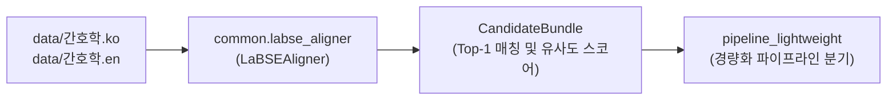
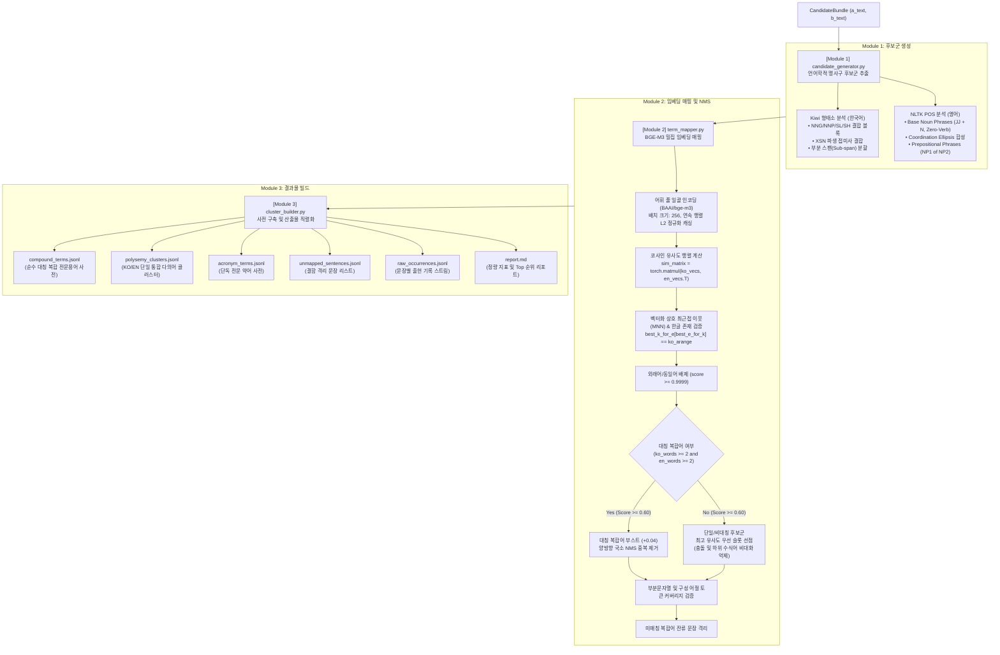

# Lightweight Terminology Extraction Pipeline Architecture

## 1. 개요 및 설계 철학

`pipeline_lightweight`는 대규모 LLM 추론 비용과 지연 시간(Latency) 없이, 언어학적 형태소 패턴과 다국어 밀집 임베딩(Dense Embedding) 매핑만으로 고정밀 다국어 전문용어 사전과 다의어 클러스터를 구축하는 고속 경량화 파이프라인입니다.

- **도메인 정규식 배제 (Zero-Domain-Regex)**: 특정 분야에 편향된 하드코딩 정규식을 일체 배제하고, 품사 태깅 규칙과 의미 밀도(Semantic Density)에 기반합니다.
- **실시간 고속 처리 (~20 문장/초)**: BGE-M3 밀집 임베딩을 후보군 단위로 일괄 사전 인코딩(Batch Precomputation)하여 중복 연산을 제거합니다.
- **대칭 복합어 및 통합 다의어 분리**: 복합 전문용어와 1:N 다의어/동의어를 명확히 구분하여 이중 사전으로 구조화합니다.

---

## 2. 입력 인터페이스 (Common 모듈 분기점)

`common.labse_aligner.py`의 `LaBSEAligner`가 생성한 사전 정렬 번들(`CandidateBundle`)을 입력 데이터로 넘겨받습니다.



### `CandidateBundle` 수신 데이터 규격
- `a_sent_id`: Language A 문장 고유 식별자 (예: `KO_0001`)
- `a_text`: Language A 원문 텍스트
- `alignment_tier`: 문장 정렬 신뢰도 등급 (기본적으로 `MATCHED` ($\ge 0.72$) 등급만 매핑에 투입하며, `--include_gray_zone` 옵션 시 `GRAY_ZONE` 포함)
- `candidates[0]`: Top-1 매칭 결과 객체 (`CandidatePair`)
  - `b_sent_id`: Language B 매칭 문장 식별자 (예: `EN_0001`)
  - `b_text`: Language B 원문 텍스트
  - `score`: 문장 수준 LaBSE 코사인 유사도 ($\ge 0.72$ MATCHED)

---

## 3. 세부 모듈별 아키텍처 및 작업 설계



---

### 모듈 1: 형태소 분석 및 후보군 생성 (`candidate_generator.py`)

- **클래스**: `CandidateGenerator`
- **목적**: 원문 문장으로부터 전문용어가 될 수 있는 형태소 결합 블록을 언어별 특성에 맞추어 누락 없이 추출.

#### 1) 한국어 후보군 추출 (`extract_ko_candidates`)
- 엔진: `Kiwi` 형태소 분석기
- **Pattern 1 (명사 및 외래 문자열 연속 블록)**:
  - `NNG`(일반명사), `NNP`(고유명사), `SL`(알파벳), `SH`(한자)의 연속 결합.
  - 서술격 조사 파생 접미사(`XSV`, `XSA`, 예: '파악+한다', '조사+하였다', '교육+하였다')와 결합된 용언화 어근은 선제 배제.
- **Pattern 2 (파생 접미사 결합)**:
  - 선행 명사 블록에 공백 없이 결합된 `XSN`(명사파생접미사, 예: '부담+감', '위험+성')을 복합명사 블록에 통합.
- **Pattern 3 (복합 명사 블록의 연속 부분 스팬 분할)**:
  - 길이 $M \ge 2$인 명사 블록에서 가능한 모든 하위 연속 명사 스팬(Sub-spans)을 추가 추출하여 복합어 분해 및 단일 명사 후보 확보.
  - XSN으로 시작하는 비문 스팬(예: '당 중재', '별 차이')은 자동 배제.
  - 임의의 기능동사 블랙리스트나 정규식 없이 순수 형태소 품사 태깅(`NNG`, `NNP`, `XSN`)에만 기반하여 안전하게 작동.

#### 2) 영어 후보군 추출 (`extract_en_candidates`)
- 엔진: `NLTK` POS 태거 및 토크나이저
- **기저 명사구 (Base NP, Zero-Verb Policy)**:
  - `[JJ | JJR | JJS]* [NN | NNS | NNP | NNPS]+` 패턴 인식 (동명사/현재분사 `VBG`, 과거분사 `VBN` 완전 배제).
  - 복합어 내부의 개별 핵심 명사 토큰도 단일 후보로 등록.
- **등위 접속 생략 복원 (Coordination Ellipsis)**:
  - `JJ + N1 + , + N2` 구조(쉼표 연결 한정)에서 수식어를 공유하는 `JJ + N2` 합성 후보 자동 생성 (`and`/`or` 등 접속사 연결은 불필요한 수식어 전파 방지를 위해 합성 배제).
- **전치사구 결합 명사구 (Prepositional Phrases, Strict 'of' Only)**:
  - `NP1 + of + (the | a | an)? + NP2` 결합 (예: `quality of life`, `burden of care`, `standard of care`). 서술적 절 비대화를 유발하는 `in`, `for`는 원천 차단.

---

### 모듈 2: BGE-M3 밀집 임베딩 매핑 (`term_mapper.py`)

- **클래스**: `TermMapper`
- **목적**: 한국어/영어 후보군 간 교차 언어 의미적 유사도를 측정하고, NMS 및 충돌 해소 알고리즘으로 최적의 매핑 쌍을 선별.

#### 1) 일괄 임베딩 사전 인코딩 (`precompute_embeddings`)
- 모델: `BAAI/bge-m3` (L2 정규화 벡터)
- 전체 문장에서 추출된 고유 문자열 풀을 배치 단위(`batch_size=256`)로 일괄 인코딩하여 캐싱함으로써 문장별 중복 연산 오버헤드 원천 제거.

#### 2) 매핑 및 분류 기준 (`map_bundle`)
- 코사인 유사도 행렬 계산:
  $$\text{sim\_matrix}_{i, j} = \mathbf{v}_{\text{ko}, i} \cdot \mathbf{v}_{\text{en}, j}$$
- **상호 최근접 이웃 (Mutual Nearest Neighbor, MNN) 검증**:
  - 한국어 후보 $i$의 최적 영어 후보 $j = \text{argmax}_j(\text{sim}_{i, j})$가 성립하고, **동시에 영어 후보 $j$의 최적 한국어 후보 역시 $i = \text{argmax}_i(\text{sim}_{i, j})$인 경우에만** 유효 후보로 승인.
  - 이를 통해 특정 고빈도 어휘(`study`, `research`)가 대응어가 없는 잔여 단어들을 모두 흡수하는 블랙홀/진공청소기 오염을 원천 차단.
- **외래어/동일어 및 비한글 문자열 자동 배제**:
  - 한국어 후보는 반드시 한글 글자(`[가-힣]`)를 포함해야 함 (순수 영문 약어/기호 `PHQ`, `COVID`, `AAA` 등의 유출 차단).
  - 유사도 $\ge 0.9999$ 또는 대소문자 무시 동일 문자열은 자동 배제.
- **분류 기준**:
  - **대칭 복합어 (`is_sym_compound`)**: `ko_words >= 2` **AND** `en_words >= 2`
    - 임계치: `score >= 0.60`
    - 대칭 보너스: 복합어 우선 선점을 위해 `score + 0.04` 부스트 부여.
  - **단일 명사 및 비대칭 쌍 (`polysemy_candidates`)**: `ko_words == 1` **OR** `en_words == 1`
    - 임계치: `score >= 0.60` (상호 최근접 합의 필수)

#### 3) 국소 NMS 및 의미 충실도 기반 슬롯 선점
- **대칭 복합어 양방향 NMS**:
  - 영어 토큰 시퀀스 겹침(`_token_contains_en`) 및 한국어 경계 겹침이 동시에 발생하는 하위 쌍을 억제하여 최장/최적 복합어만 선별.
- **다의어/단일 후보 국소 충돌 해소 (Local Conflict Resolution)**:
  - 코사인 유사도 내림차순 정렬.
  - 이미 선정된 대칭 복합어의 하위 구성요소로 포함되거나 동일 영어 토큰을 공유하며 수식어만 비대해진 변형(`_ko_overlap and _en_overlap`)인 경우 제외.
  - **의미 충실도 우선 규칙**: 동일한 단어(예: `health`)에 대해 유사도가 더 높은 후보(`건강`, 0.88)가 슬롯을 선점하고, 후순위의 불필요한 수식어 비대화 후보(`건강 관리`, 0.62)는 충돌 감지를 통해 자동 차단.

#### 4) 결함 문장 격리 (`unmapped_sentences`)
- 양방향 부분문자열 및 구성 어절 토큰 커버리지 규칙:
  - 한국어 후보 중 매칭된 용어와 부분문자열 포함 관계(`(k in m) or (m in k)`) 및 구성 어절 토큰 겹침(`any(w in matched_tokens for w in k.split())`)이 모두 없는 잔여 후보 탐색.
  - 잔여 후보 중 **2어절 이상의 복합명사(`is_ko_compound`)가 남아있는 경우에만** 해당 문장을 결함 의심 문장으로 판정하여 격리.

---

### 모듈 3: 클러스터 빌더 및 아티팩트 익스포터 (`cluster_builder.py`)

- **클래스**: `ClusterBuilder`
- **목적**: 매핑된 원시 레코드를 중복 제거하고, 표준 규격의 단일 파일들로 직렬화.

#### 1) 대칭 복합 전문용어 사전 (`save_compound_terms`)
- 파일: `output/lightweight/compound_terms.jsonl`
- 양쪽 언어 모두 2어절 이상인 용어 쌍 집계.
- 빈도수(`frequency`) 내림차순 정렬 및 대표 출처 문장 ID 최대 5개 기록.

#### 2) 단일 통합 다의어/동의어 클러스터 (`save_unified_polysemy_clusters`)
- 파일: `output/lightweight/polysemy_clusters.jsonl`
- 기존 3개 파일로 분리되던 파편화를 단 1개의 파일로 통합.
- 앵커 단어가 1단어인 경우 해당 단어를 기준으로 1:N 번역어 클러스터 구성:
  - `anchor_lang == "en"`: 영어가 1단어인 케이스 (예: `factors` $\rightarrow$ `요인` 10회, `영향` 1회)
  - `anchor_lang == "ko"`: 한국어가 1단어인 케이스 (예: `연구` $\rightarrow$ `study` 15회, `research` 8회)
- 전체 코퍼스 등장빈도(`total_frequency`) 역순 내림차순 전수 정렬.

#### 3) 단독 전문 약어 사전 (`extract_and_save_acronym_terms`)
- 파일: `output/lightweight/acronym_terms.jsonl`
- 2자 이상, 순수 숫자 제외, 영문 대문자 2자 이상 포함인 단독 약어(Acronym)를 별도 파일로 분리 수록.
- 문장 단위 중복 방지 및 `re.ASCII` 단어 경계로 한국어 조사 결합형 약어(`HPV를`, `BMI가`) 누락 차단.
- `HPV`, `OECD`, `EVD`, `NSSI`, `BMI`, `CAPD`, `ADHD` 등 의학/학술 핵심 약어 보존.

#### 4) 결함 문장 목록 및 리포트
- `unmapped_sentences.jsonl`: 원문 텍스트, 미매칭 복합어 목록, LaBSE 점수 기록.
- `raw_occurrences.jsonl`: 문장별 매핑 출현 스트림 전수 보존.
- `report.md`: 처리 속도, 어휘 통계, Top 약어, Top 다의어 허브, Top 복합어 랭킹 요약 마크다운.

---

## 4. 데이터 스키마 명세

### `compound_terms.jsonl`
```json
{
  "surface_a": "사회적 지지",
  "surface_b": "social support",
  "canonical_a": "사회적 지지",
  "canonical_b": "social support",
  "frequency": 8,
  "sample_sources": ["KO_0068:EN_0068", "KO_0422:EN_0422"],
  "category": "compound_term"
}
```

### `acronym_terms.jsonl`
```json
{
  "acronym": "HPV",
  "surface_a": "HPV",
  "surface_b": "HPV",
  "frequency": 8,
  "sample_sources": ["KO_0001:EN_0001", "KO_0735:EN_0735"],
  "category": "acronym"
}
```

### `polysemy_clusters.jsonl`
```json
{
  "anchor_term": "factors",
  "anchor_lang": "en",
  "canonical_term": "factors",
  "total_frequency": 11,
  "distinct_translations": 2,
  "translations": [
    {
      "term": "요인",
      "frequency": 10,
      "sample_sources": ["KO_0058:EN_0058"]
    },
    {
      "term": "영향",
      "frequency": 1,
      "sample_sources": ["KO_0164:EN_0164"]
    }
  ]
}
```

### `unmapped_sentences.jsonl`
```json
{
  "source_a_id": "KO_0001",
  "source_b_id": "EN_0001",
  "a_text": "원문 한국어 문장...",
  "b_text": "Original English sentence...",
  "labse_score": 0.8412,
  "uncovered_compounds": ["접종 이행"]
}
```

---

## 5. 실행 엔트리포인트 및 CLI 옵션

`03-word-candidates/`에서 실행한다.

```bash
# 최대 1,000문장으로 확인
python co-work/run_mapping.py --candidates_file /경로/3_complete.jsonl \
    --max_count 1000 --output_dir /경로/후보-매핑-샘플

# 전체 코퍼스 일괄 처리
python co-work/run_mapping.py --candidates_file /경로/3_complete.jsonl \
    --output_dir /경로/후보-매핑-결과
```
